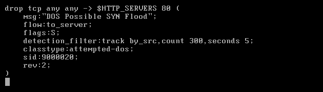
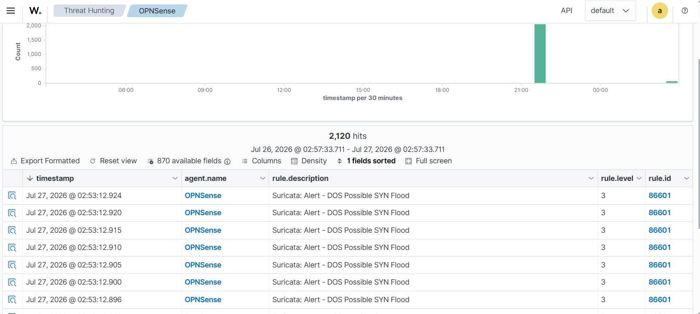
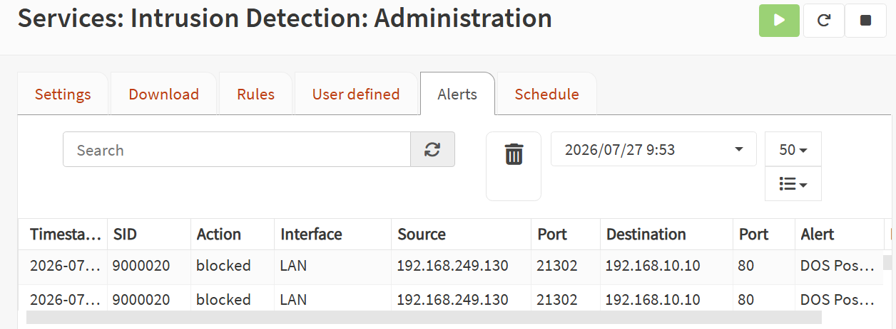

# Demo 01 — SYN-flood detection and blocking

[← Project overview](../../README.md)

## Objective and environment

Detect TCP SYN traffic from the WAN-side Kali host toward the published web service and inspect both network enforcement and SIEM ingestion.

| Item | Recorded value |
|---|---|
| Source | `192.168.249.130` |
| Published target | `192.168.249.134:80` |
| Internal web server | `192.168.10.10:80` |
| Sensor/enforcement | Suricata on OPNsense |

## Detection configuration

The shown rule has action **`drop`**, SYN flag **`S`**, destination **`$HTTP_SERVERS 80`**, `flow:to_server`, and source-tracked `detection_filter` with count **300** and window **5 seconds**. Its signature is **DOS Possible SYN Flood**, SID **9000020**.

These are the recorded configuration values; the report does not provide a controlled packet-count experiment establishing the exact first-drop boundary.

## Recorded workflow

1. Configure the Suricata signature on OPNsense.
2. Generate SYN traffic from Kali toward the published HTTP service.
3. Inspect OPNsense intrusion-detection alerts.
4. Confirm that related events appear under the OPNsense agent in Wazuh.

## Dashboard and SIEM logs

Visible events use Wazuh rule **86601**, level **3**, description **Suricata: Alert - DOS Possible SYN Flood**.

## Enforcement evidence

The alert rows show **blocked**, source **192.168.249.130**, destination **192.168.10.10**, port **80**, on the **LAN** interface. The destination reflects the internal server after the WAN publishing path.

## Result

The supplied evidence shows matching network alerts, a blocked action on OPNsense, and forwarded events in Wazuh. It does not quantify HTTP availability during the flood, maximum sustainable throughput, or packet-loss/latency effects.

**Source:** report pages 73–74; all demo screenshots are on page 74.
