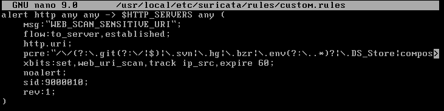
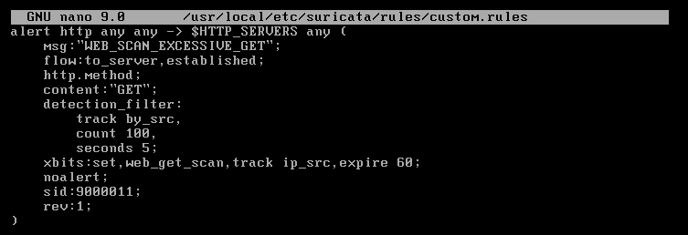
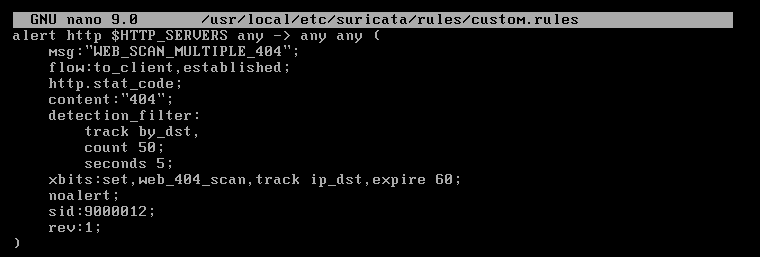
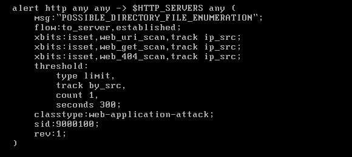
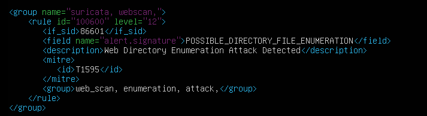
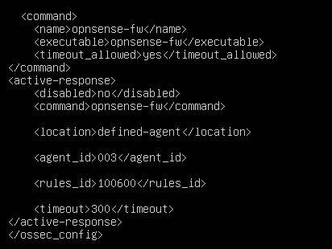
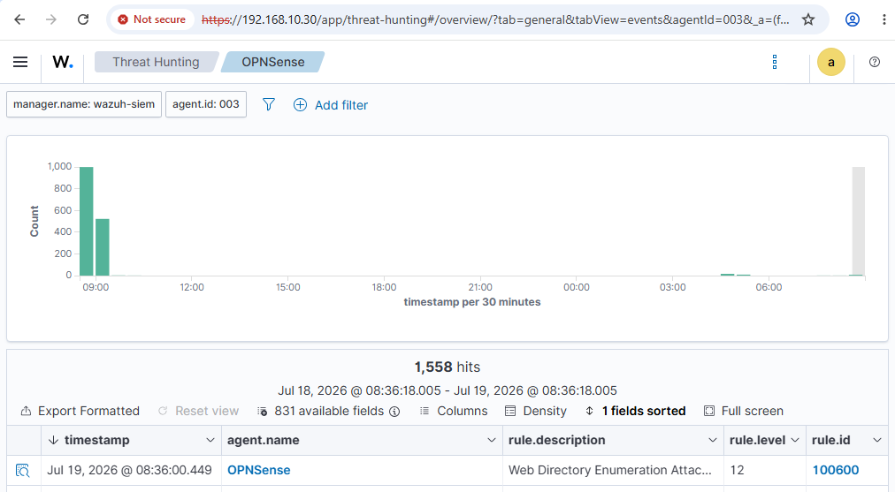
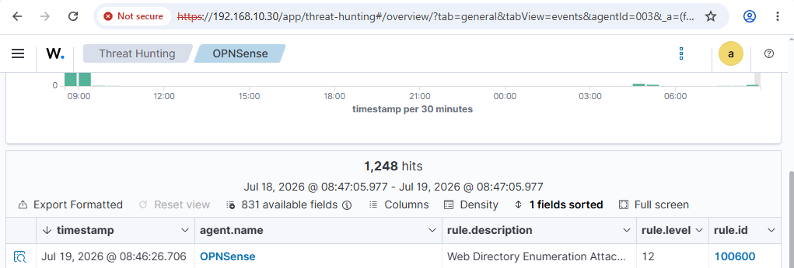
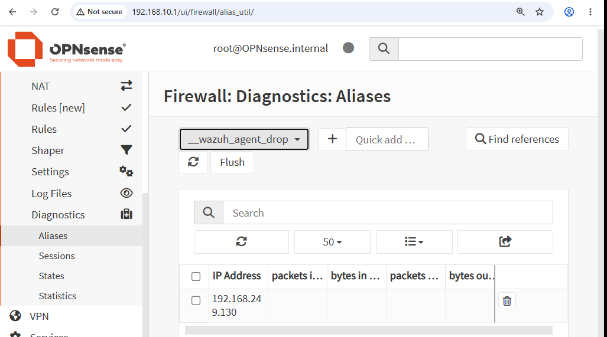
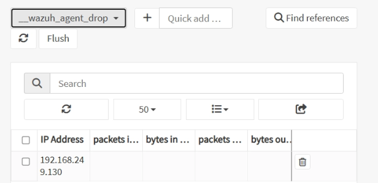

# Demo 02 — Web directory enumeration and firewall containment

[← Project overview](../../README.md)

## Objective

Detect scanning behavior using multiple HTTP indicators, promote the combined event in Wazuh, and block the source through the OPNsense Wazuh Agent.

## Network detection design

The report uses Suricata **xbits** to retain three indicators per client: sensitive URI access, excessive GET requests, and repeated HTTP 404 responses. Intermediate signatures use `noalert`; a combined rule checks all three bits before producing the main alert.

The combined signature is **`POSSIBLE_DIRECTORY_FILE_ENUMERATION`**, SID **9000100**. Its screenshot limits alerts to one per source within **300 seconds**. This alert-rate limit is separate from the firewall block timeout.

## Wazuh detection and response

The custom Wazuh rule **100600** matches the Suricata signature, raises severity to **12**, and describes **Web Directory Enumeration Attack Detected**.

The response calls **`opnsense-fw`**, targets **defined-agent 003**, selects rule **100600**, and configures a **300-second** timeout. Agent ID 003 is specific to the recorded lab.

## Dashboard and SIEM logs

### Gobuster exercise

### Dirsearch exercise

Both captures display rule **100600**, level **12**, under the OPNsense agent. Only these two tools have dedicated exercise evidence in the report; other tool names in the narrative are not presented here as separately verified runs.

## Firewall enforcement evidence

Source **`192.168.249.130`** appears in **`__wazuh_agent_drop`**, as spelled in the GUI. The report also records another firewall-alias capture after the Dirsearch exercise and a subsequent HTTP request without a visible response. The alias captures provide direct firewall-table evidence; the HTTP request is supporting context.

## Result

The demo documents the chain **HTTP indicators → Suricata combined alert → Wazuh level-12 event → OPNsense IP containment**. It does not include a timed unblock test, a normal-browser false-positive baseline, or a comparative detection-rate benchmark.

**Source:** report pages 75–80.
