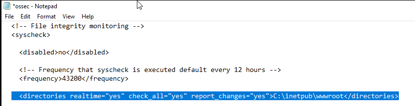
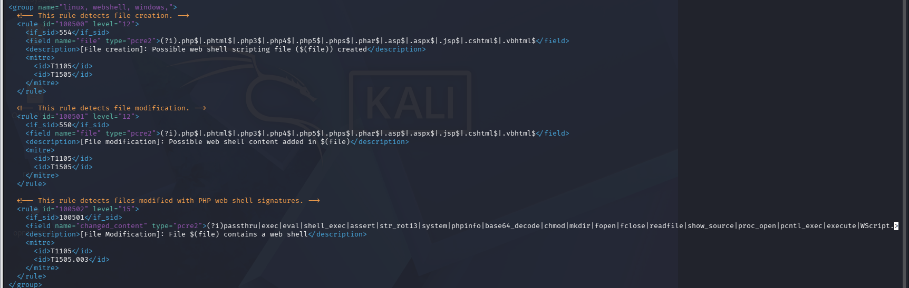
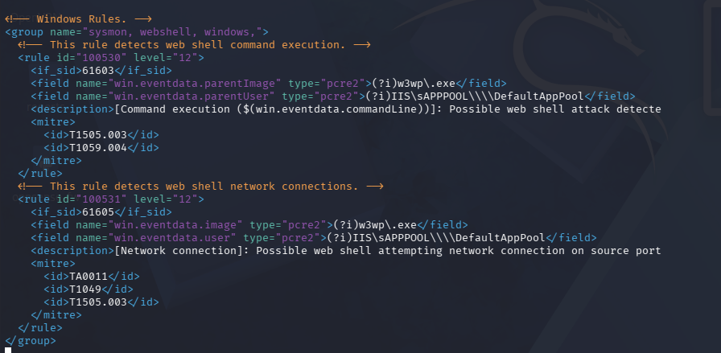
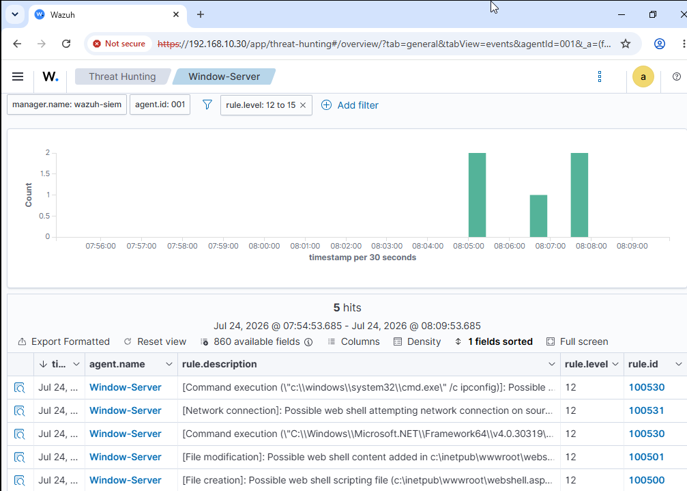
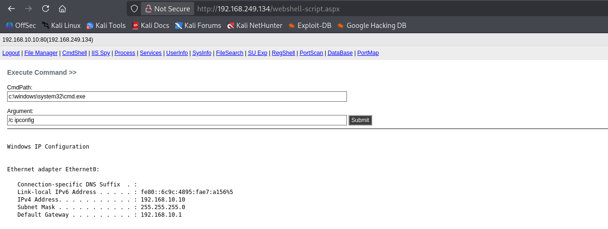

# Demo 03 — IIS web-shell detection with FIM and Sysmon

[← Project overview](../../README.md)

## Objective

Observe file changes and command/network behavior during a controlled IIS web-shell exercise on the Windows Server.

| Item | Recorded context |
|---|---|
| Target host | Windows Server, `192.168.10.10` |
| Published HTTP address | `192.168.249.134` |
| Monitored directory | IIS webroot under `C:\inetpub\wwwroot` |
| File telemetry | Wazuh FIM |
| Behavior telemetry | Sysmon events collected by Wazuh Agent |

## File monitoring

The report configures FIM and custom rules to flag potentially relevant web scripting files. A file extension match identifies a candidate event; it does not by itself establish that every matching file is malicious.

## Process and network monitoring

The report adds Sysmon-based rules for suspicious command execution and network activity in the IIS context. The captured exercise includes web-shell file placement, command execution, and an outbound TCP connection request.

## Dashboard and SIEM logs

| Rule | Visible result |
|---|---|
| **100500** | Possible web-shell scripting file created |
| **100501** | Possible web-shell content added by file modification |
| **100530** | Command-execution alerts, including `cmd.exe /c ipconfig` |
| **100531** | Possible web-shell network connection |

The five visible rows have level **12**. The screenshot includes two command-execution rows, so five rows do not represent five distinct attack techniques. The configured content rule **100502** is shown in the rule screenshot but is not displayed as a matched event in the final alert table.

## Execution evidence

The recorded command output identifies the Windows server's IP **192.168.10.10** and gateway **192.168.10.1**. This supports the command-execution portion of the exercise. The separate network alert establishes observed network activity, without requiring a claim that a full interactive reverse-shell session was proven.

## Result

FIM and Sysmon-based events expose file creation/modification, command execution, and network activity in Wazuh. No automatic web-shell deletion, process termination, or source-IP block is shown for this demo. The repository preserves detection evidence and excludes the web-shell payload itself.

**Source:** report pages 80–84.
