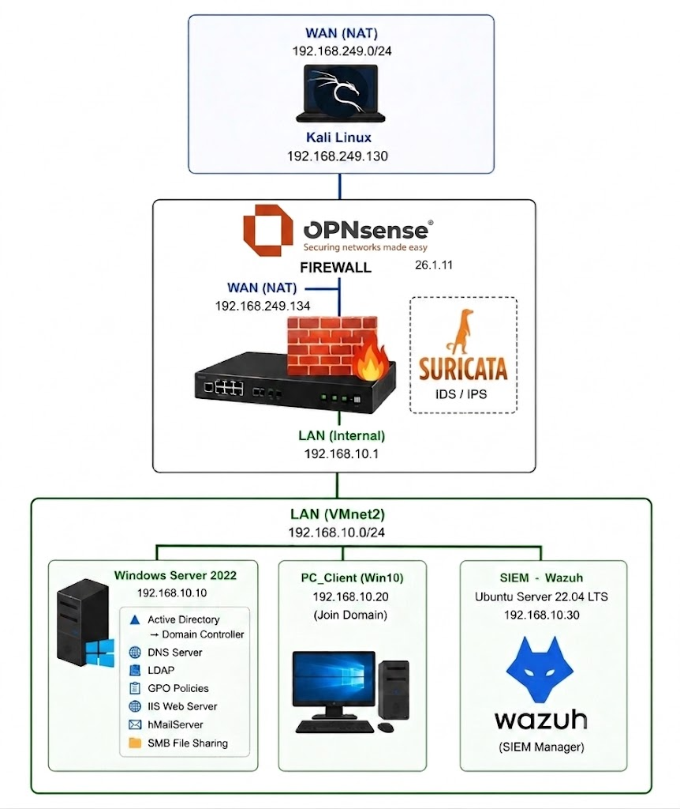
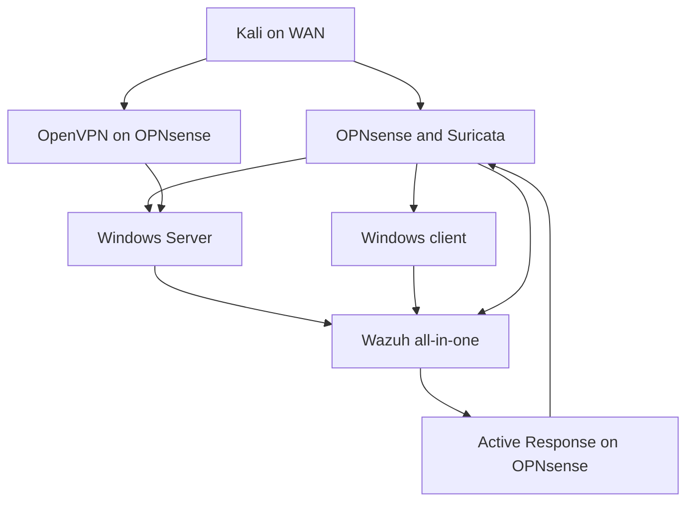

# Architecture and network inventory

[← Project overview](../README.md)

## Topology

The lab uses two VMware Workstation networks. VMnet8 NAT represents WAN and provides upstream connectivity; VMnet2 connects the domain LAN. OPNsense has an interface in each segment and serves as the LAN gateway. The WAN segment is a lab network, not a public Internet address range.

| Network | Address range | Purpose |
|---|---|---|
| VMnet8, NAT | `192.168.249.0/24` | WAN simulation and Kali test host |
| VMnet2, custom | `192.168.10.0/24` | Domain servers, workstation, and Wazuh |
| VPN tunnel, visible in results | `10.10.0.0/24` | OpenVPN client addressing |

## Machine inventory

| Host | OS | IP | Responsibilities |
|---|---|---|---|
| Kali | Kali Linux | `192.168.249.130` | WAN-side simulation and VPN client |
| OPNsense | OPNsense | WAN `.249.134`; LAN `.10.1` | Routing, NAT, firewall, Suricata, OpenVPN |
| Domain server | Windows Server 2022 | `192.168.10.10` | AD DS, DNS, LDAP, SMB, mail, IIS |
| Workstation | Windows 10 | `192.168.10.20` | Domain membership, user/service/policy tests |
| SIEM | Ubuntu Server 22.04 LTS | `192.168.10.30` | Wazuh Manager, Indexer, Dashboard |

Windows clients use `192.168.10.10` for DNS and `192.168.10.1` as gateway. The Wazuh server uses the same domain DNS and gateway. The domain is `trungnh.local`.

## Traffic and monitoring paths

| Path | Function |
|---|---|
| WAN address port 80 → server port 80 | Publish IIS through destination NAT |
| WAN UDP 1194 → OpenVPN | Remote access into LAN |
| Windows Agent → Wazuh | Windows event and Sysmon collection |
| OPNsense Agent → Wazuh | Firewall-side intrusion-detection events |
| Wazuh → OPNsense Agent | Directory-enumeration IP containment |

The diagram summarizes implemented relationships rather than implying that every internal LAN flow traverses the firewall. AD DS, IIS, SMB, and mail share one Windows Server in this lab.

## Platform scope

The SIEM uses native **Wazuh Manager + Wazuh Indexer + Wazuh Dashboard**. This report does not describe a separate Logstash/Elasticsearch/Kibana deployment. Exact Wazuh, OPNsense, Suricata, IIS, and hMailServer release/build versions are not consistently established; the explicitly stated OS versions are retained.

**Source:** report pages 1–9 and 65–73.
