# Domain identity and application services

[← Project overview](../README.md)

## Active Directory

Windows Server 2022 is promoted to a domain controller for a new forest, **`trungnh.local`**. Windows 10 uses the DC for DNS and joins the domain.

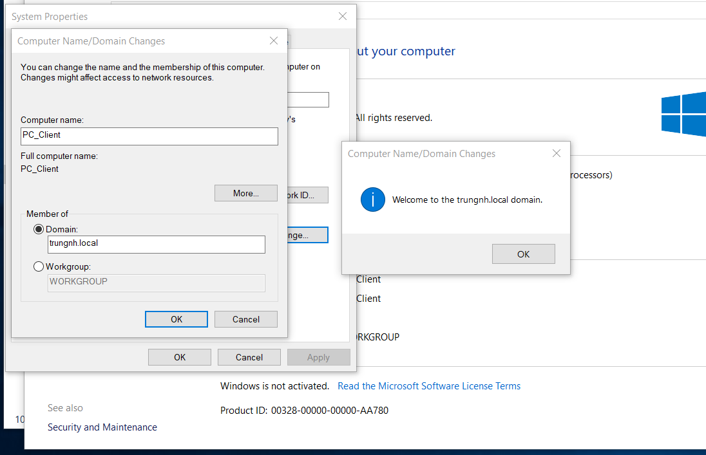

The report creates IT and Sales OUs, `IT_Group` and `Sales_Group`, and users `it01`, `it02`, `sale01`, and `sale02` in their respective groups.

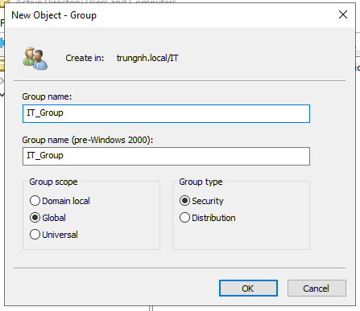

## SMB authorization

The server hosts IT and Sales subfolders under a shared directory. Share permissions and NTFS permissions are configured for each department's security group.

| Test identity | Own department | Other department |
|---|---|---|
| `it01` | IT access allowed | Sales access denied |
| `sale01` | Sales access allowed | IT access denied |

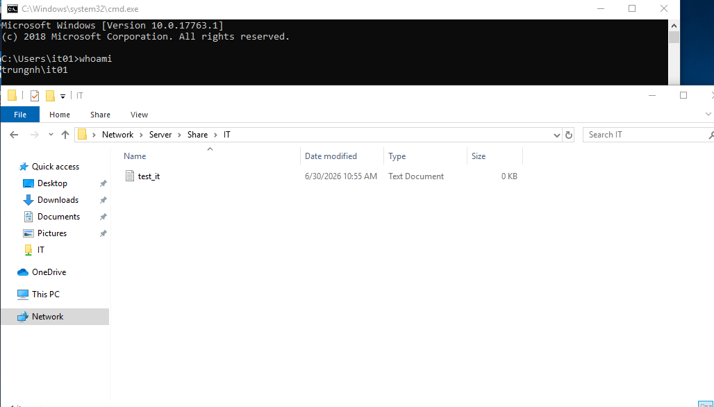

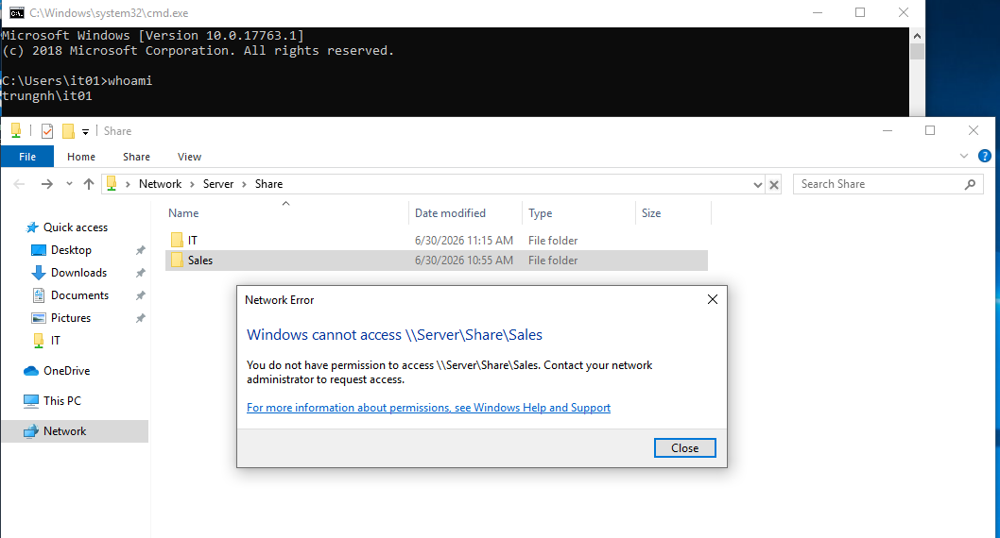

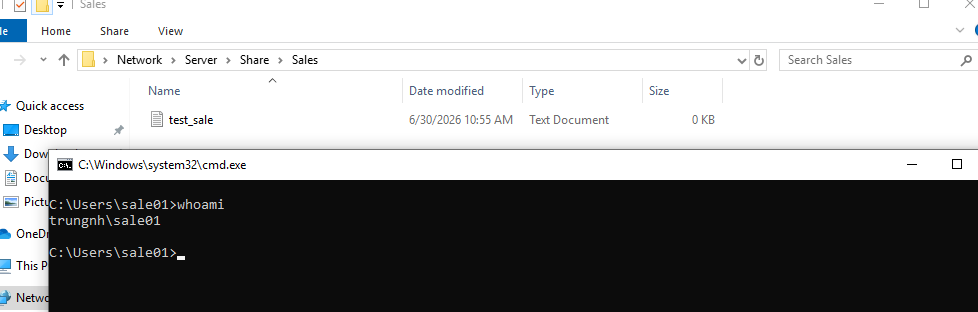

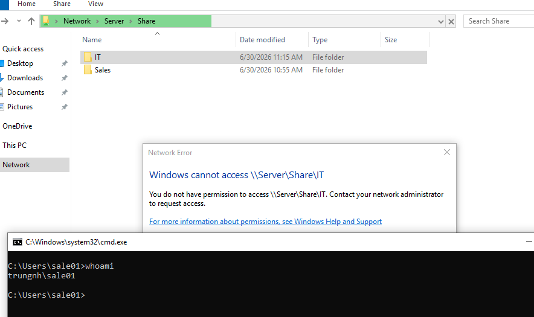

These tests validate the demonstrated departmental separation; a full permission audit of privileged users and inherited ACLs is not supplied.

## LDAP and DNS

LDP.exe is used to connect and bind to AD, browse directory objects, and query `it01`. The report includes the returned user attributes. The LDAP exercise does not establish a separately validated LDAPS deployment.

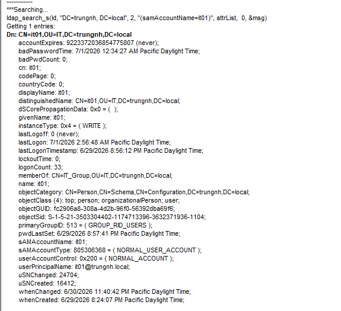

DNS work includes forward records for services, reverse lookup/PTR records, and the mail MX record. `nslookup` output records lookup validation.

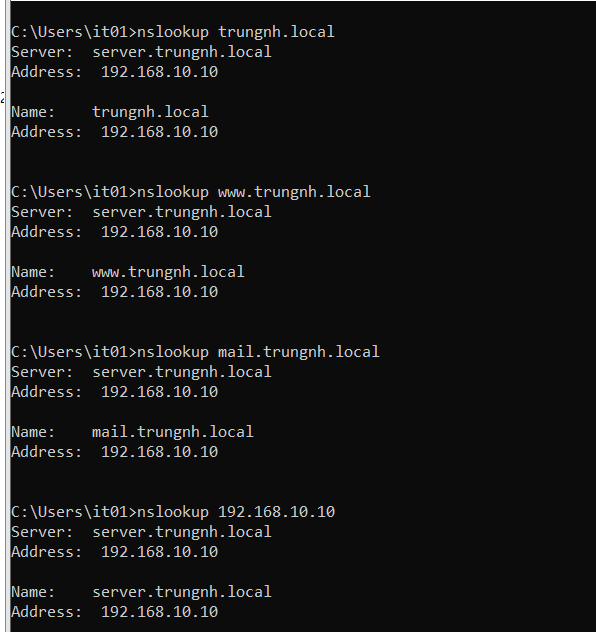

## Internal email

hMailServer hosts mail for `trungnh.local`; Thunderbird is used for `it01@trungnh.local` and `sale01@trungnh.local`. The report records a message sent from IT and received by Sales.

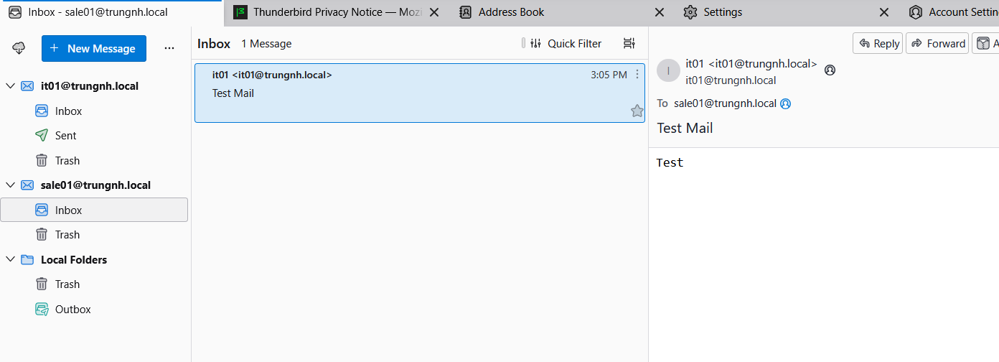

This validates internal delivery in the lab; public Internet mail delivery, mail-domain reputation, and production mail hardening are outside the recorded test.

## IIS, ASPGoat, and web publishing

IIS serves the Windows web workload. ASPGoat is deployed as an ASP.NET Core application under `C:\inetpub\AspGoat` with the hosting bundle and IIS integration. The report records successful access from Kali and an IIS hostname binding for `www.trungnh.local`. The recorded browser test shows ASPGoat reached at `trungnh.local`.

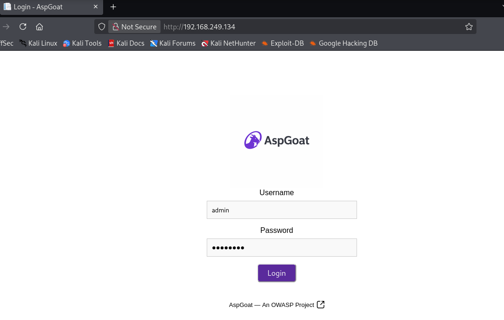

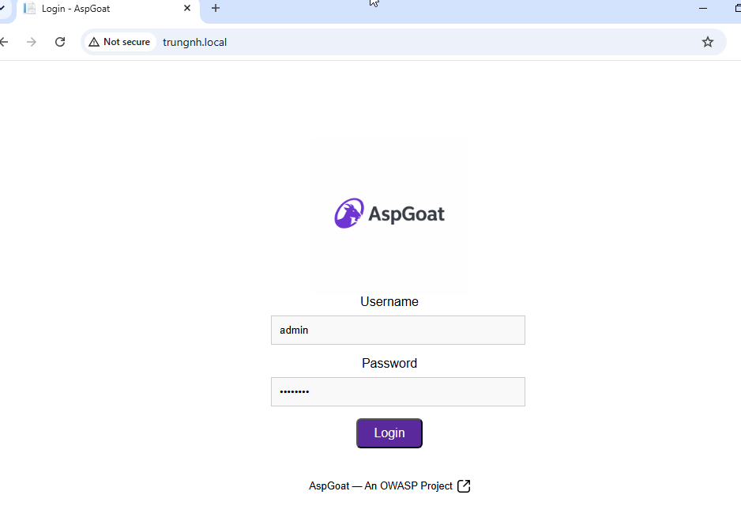

The earlier IIS validation also demonstrates LAN access. OPNsense destination NAT publishes WAN address port 80 to `192.168.10.10:80`.

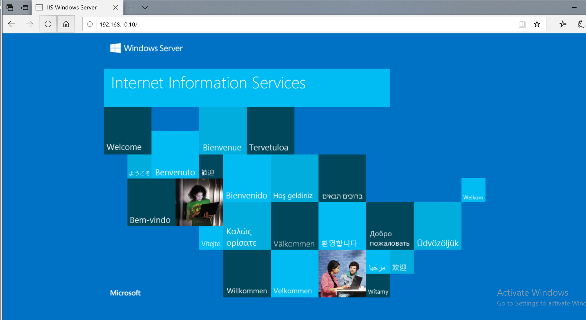

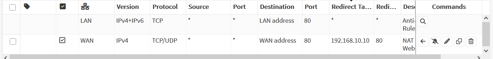

**Source:** report pages 9–41. Screenshots are indexed individually in the [evidence index](evidence-index.md).
