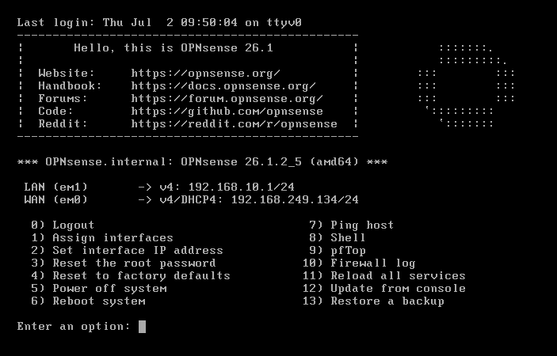
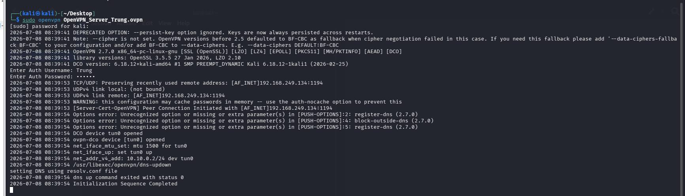
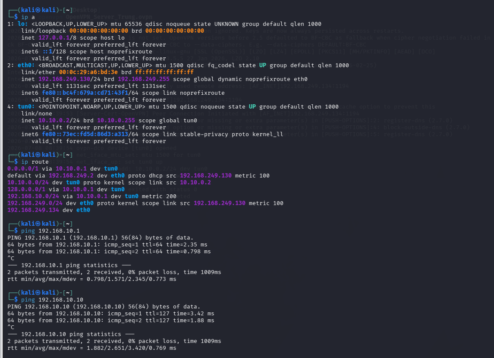

# OPNsense perimeter security and OpenVPN

[← Project overview](../README.md)

## Perimeter role

OPNsense bridges the lab's WAN/LAN routing boundary, provides NAT and access-control rules, hosts Suricata, and terminates OpenVPN. It is the default gateway at `192.168.10.1` for internal machines.

## Web publishing

A destination-NAT rule maps WAN address `192.168.249.134`, port 80, to the IIS server `192.168.10.10`, port 80. This gives the WAN-side lab host a controlled path to the test website.

## Suricata network monitoring and prevention

The report enables intrusion detection on WAN and LAN, downloads rules, and enables syslog alert/EVE output. A preliminary scan generates IDS alerts. The SYN-flood exercise then includes a `drop` rule and alert rows explicitly marked **blocked**, providing separate evidence of enforcement.

The directory-enumeration exercise uses Suricata to generate a correlated alert, then Wazuh Active Response invokes `opnsense-fw` on the firewall agent to add the attacking source to a firewall alias. That is a distinct containment path from Suricata's direct packet drop.

## OpenVPN deployment

The report documents a local CA, server certificate, user/client certificate, OpenVPN instance, interface assignment, WAN UDP **1194** allowance, VPN-to-LAN rules, and client export.

### Client connection result

### Tunnel and reachability result

| Evidence | Visible result |
|---|---|
| Client interface | `tun0`, address `10.10.0.2/24` |
| Internal route | `192.168.10.0/24` through the VPN |
| Gateway reachability | Replies from `192.168.10.1` |
| Server reachability | Replies from `192.168.10.10` |

The recorded client log completes initialization while also showing option warnings. The portfolio preserves that result rather than asserting a warning-free deployment. Certificate private keys and exported VPN profiles are not included.

**Source:** report pages 4–5, 38, and 52–64.
