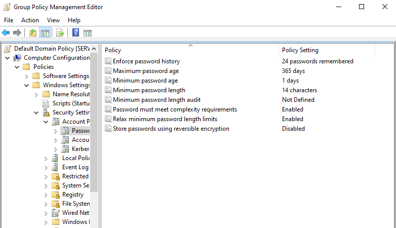
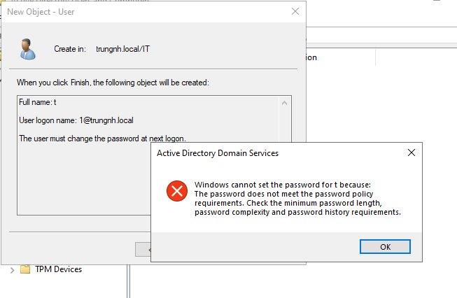
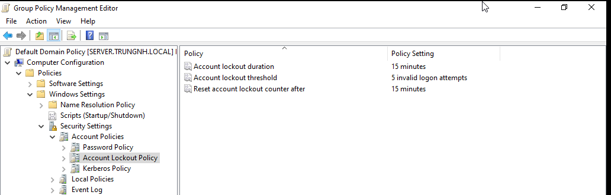
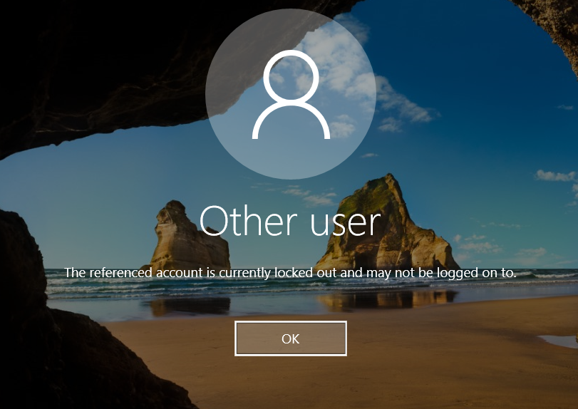
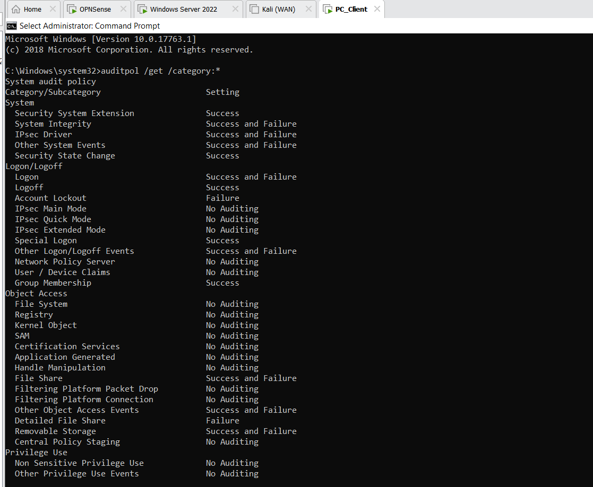
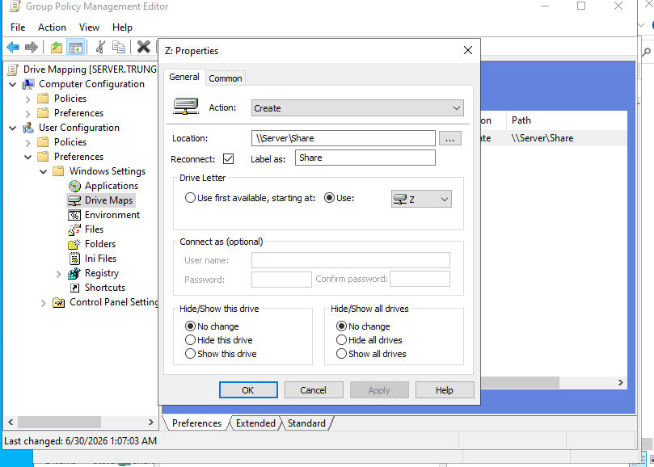
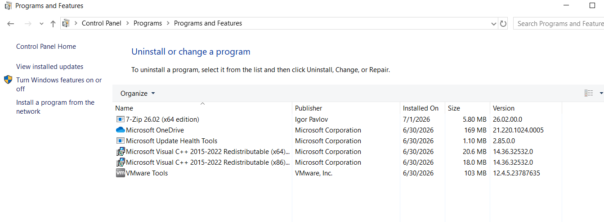
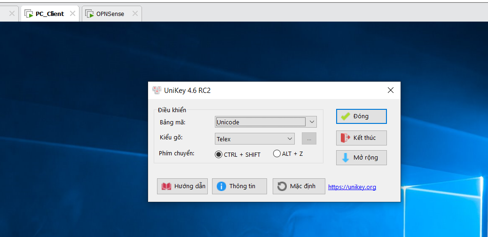

# Group Policy deployment and validation

[← Project overview](../README.md)

## Implemented policies

| Policy/workflow | What is configured | Recorded outcome |
|---|---|---|
| Password policy | Domain password requirements | Nonconforming password rejected |
| Account lockout | Failed-login restrictions | Report records lockout after five failed attempts |
| Advanced audit policy | Windows audit categories | Client audit-policy output recorded |
| Drive mapping | Shared directory mapped as `Z:` | Mapping policy and update documented; automatic appearance is described |
| MSI deployment | 7-Zip deployment | Client software verification shown |
| User logon script | Start UniKey from shared storage | UniKey running after domain logon |

## Password policy

## Account lockout

## Audit policy

## Drive mapping

## Software deployment and user logon automation

The UniKey task is documented as a **user logon script**, which is more precise than describing it as a pre-login machine startup service.

## Scope of security guidance

The report discusses CIS and NIST alongside these settings. This repository documents the applied controls and observed tests, rather than claiming a complete CIS benchmark implementation or a formal NIST compliance assessment.

**Source:** report pages 42–51.
