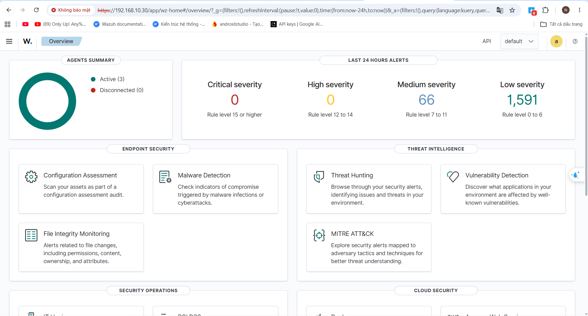
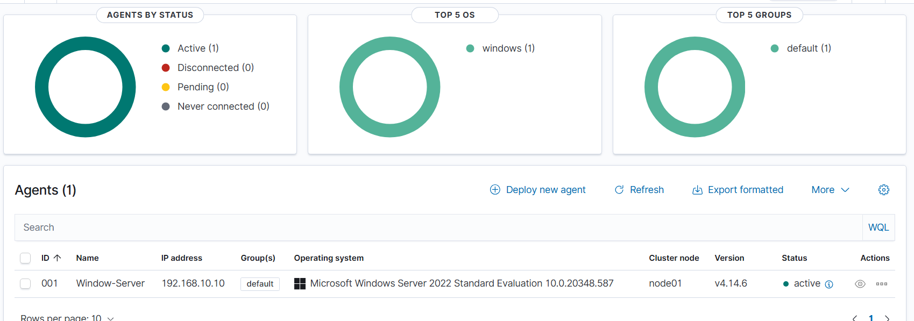
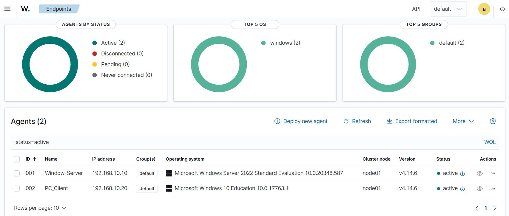
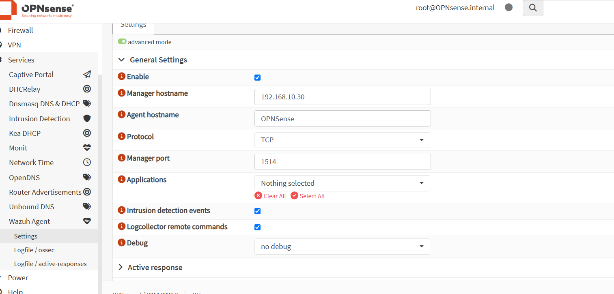
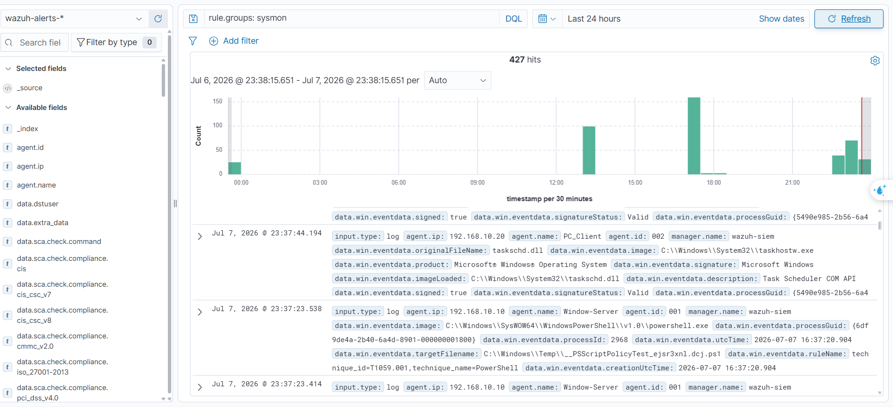

# Centralized security monitoring

[← Project overview](../README.md)

## Wazuh all-in-one

The Ubuntu server at **`192.168.10.30`** hosts Wazuh Manager, Indexer, and Dashboard. The Manager receives and analyzes events, the Indexer stores indexed data, and Dashboard provides monitoring and investigation.

## Endpoint and firewall collection

| Source | Integration | Captured evidence |
|---|---|---|
| Windows Server | Wazuh Agent | Agent active; web-shell alerts; Sysmon events |
| Windows client | Wazuh Agent | Agent active; Sysmon events |
| OPNsense | `os-wazuh-agent` plugin | Manager settings, IDS-event forwarding, and firewall-agent events in Wazuh |

The firewall agent configuration selects manager `192.168.10.30`, TCP port **1514**, and intrusion-detection events. Later demo screenshots identify the OPNsense agent as **003** and show its events in Wazuh.

## Sysmon integration

Sysmon is installed on both Windows systems. Wazuh Agent is configured to read **`Microsoft-Windows-Sysmon/Operational`**. After agent restart, Discover is filtered with `rule.groups: sysmon`.

The captured view contains events from the Windows client `192.168.10.20` and Windows Server `192.168.10.10`. This supports successful ingestion from both endpoints; the displayed hit total is tied to that filter and time window.

## Detection and response responsibilities

| Scenario | Detection | Enforcement shown |
|---|---|---|
| SYN flood | Suricata network rule and forwarded Wazuh event | Suricata blocked action on OPNsense |
| Directory enumeration | Suricata xbits plus Wazuh rule 100600 | OPNsense firewall alias through Active Response |
| Web shell | Wazuh FIM and Sysmon-based rules | Alerts; no automatic containment shown |

**Source:** report pages 65–84.
